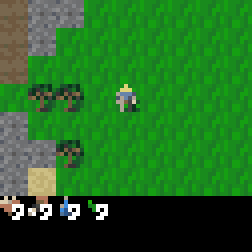
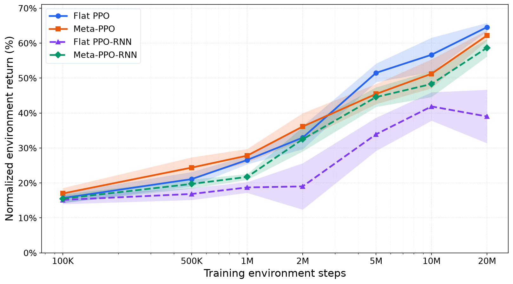
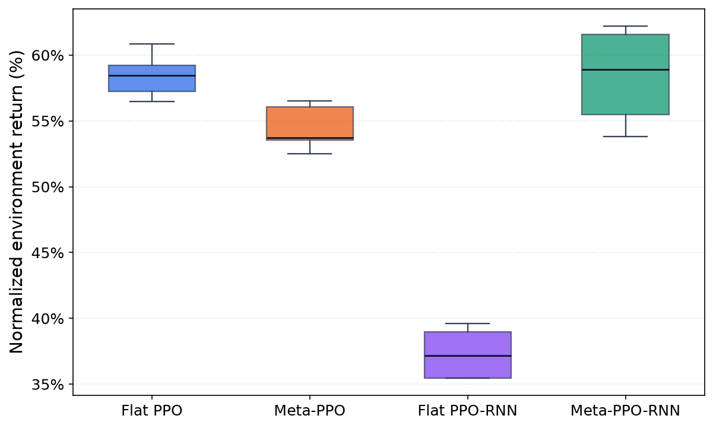

# From Skills to Survival

**Hierarchical composition of neuroevolved skills for long-horizon reinforcement learning.**
MSc AI thesis, Vrije Universiteit Amsterdam, 2026. [Read the thesis (PDF)](docs/thesis.pdf).

<p align="center">
  
  <br><em>Meta-PPO-RNN playing Craftax Classic: the controller picks a frozen skill or a direct action at every step.</em>
</p>

## Idea

Long-horizon tasks are hard for flat RL agents: rewards are sparse and the agent must explore and assign credit across hundreds of steps. This project splits the problem in two:

1. **Skills.** Six small, feed-forward policies (Collect Wood, Find Water, Hunt Food, Combat, Collect Stone, Collect Ore) are trained **independently with OpenES** (evolution strategies), each on its own bootstrapped mini-task with its own fitness function and curriculum. They are then frozen.
2. **Meta-controller.** A **PPO** agent sees the full 1345-dim [Craftax Classic](https://github.com/MichaelTMatthews/Craftax) observation and picks one of 24 meta-actions every step: 8 skill calls (the ore skill is retargeted to coal, iron, and diamond without retraining) or 16 direct actions (move, sleep, place, craft).

Each skill sees only a compact, hand-designed feature vector (target direction and distance, walkability, facing, status), not the raw observation. This keeps the skills tiny (under 2 KB each) and portable across controllers, seeds, and game variants.

## Results

Five seeds per condition, budgets from 100K to 20M environment steps, all trained on one laptop GPU (RTX 2060, 6 GB).

<p align="center">
  
</p>

- **Faster early learning.** Meta-PPO beats Flat PPO up to 2M steps (36.1 ± 3.8% vs 33.0 ± 3.3% normalized return). After that, Flat PPO overtakes it.
- **Far fewer parameters.** At 20M steps, Meta-PPO keeps 96.3% of Flat PPO's return with **83% fewer parameters**.
- **Recurrence helps the hierarchy most.** Meta-PPO-RNN beats Flat PPO-RNN during training (58.7 ± 2.5% vs 39.0 ± 7.7%). In held-out greedy evaluation it matches feed-forward Flat PPO (58.3% each) with **86% fewer parameters**, and 89.7% fewer than Flat PPO-RNN.
- **Trade-off.** Training the skill library is expensive (259M env steps, mostly Hunt Food and Combat). It is a one-time cost: the same frozen skills are reused by every controller and seed, and partly transfer to the harder Craftax Extended game.

<p align="center">
  
  <br><em>Greedy evaluation after 20M steps (5 seeds × 256 episodes).</em>
</p>

## Quickstart

```bash
python -m venv .venv && source .venv/bin/activate
pip install -r requirements.txt          # CPU; for a GPU, install jax[cuda12] as well

# Watch a frozen skill (writes a GIF to eval_weights/)
python -m evaluation.eval_find_wood --weights checkpoints/skills/find_wood.npy --seed 0

# Train the meta-controller on top of the shipped skills
python -m ppo.meta_ppo --budget 1m --seed 0
```

Run every command from the repository root. Outputs go to `runs/` (git-ignored).

## Reproducing the thesis

| Stage | Command |
| --- | --- |
| 1. Train the six skills (OpenES) | `python train_skills.py` |
| 2. Meta-PPO / Flat PPO budget sweep, 5 seeds | `./scripts/run_baseline_budget_multiseed_pipeline.sh` |
| 2b. Recurrent variants (GRU) | `./scripts/run_baseline_rnn_budget_multiseed_pipeline.sh` |
| Ablation: random (untrained) skills | `./scripts/run_meta_random_skills_ablation.sh` |
| Transfer to Craftax Extended | `./scripts/run_classic_to_full_finetune_vs_scratch.sh` |
| Figures and tables | `python -m figures.<name>` (writes to `figures/output/`) |

The thesis skill checkpoints are in [`checkpoints/skills/`](checkpoints/skills) and are the defaults for every downstream script, so stage 1 is optional. The pipeline scripts also run greedy evaluation and aggregate results across seeds.

## Repository layout

```
train_skills.py         Stage 1 entry point: trains all six skills
skills/                 OpenES training loop per skill
training/               Fitness functions, bootstrapped envs, feature filters, run utils
  craftax/              Craftax Extended variants (transfer study)
policies/               Flax networks for the skills and the meta-controller
configs/                Per-skill hyperparameters and the 24-action meta space
ppo/                    Stage 2: Meta-PPO, Meta-PPO-RNN, Flat PPO, Flat PPO-RNN
  craftax_baselines/    Vendored official Craftax PPO baselines (MIT)
evaluation/             Greedy evaluation, per-skill rollouts and GIFs, aggregation
figures/                Scripts that produce the thesis figures and tables
scripts/                Multi-seed, multi-budget experiment pipelines
checkpoints/skills/     The six frozen skills used in the thesis
```

## Stack

JAX, Flax, Optax, [evosax](https://github.com/RobertTLange/evosax) (OpenES), and [Craftax](https://github.com/MichaelTMatthews/Craftax). Environments, rollouts, and ES populations are all `jit`/`vmap`-compiled, so a full skill generation or PPO update runs on the GPU. The flat baselines and the PPO-RNN architecture follow the official [Craftax baselines](https://github.com/MichaelTMatthews/Craftax_Baselines).

## Citation

```bibtex
@mastersthesis{holtus2026skills,
  title  = {From Skills to Survival: Hierarchical Composition of Neuroevolved Skills
            for Long-Horizon Reinforcement Learning},
  author = {Holtus, Sjoerd},
  school = {Vrije Universiteit Amsterdam},
  year   = {2026}
}
```

MIT licensed. See [LICENSE](LICENSE).
